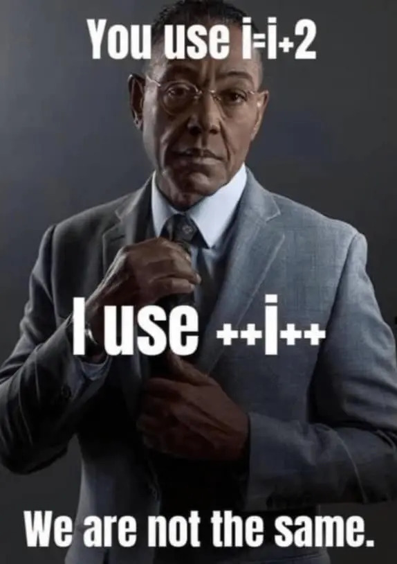
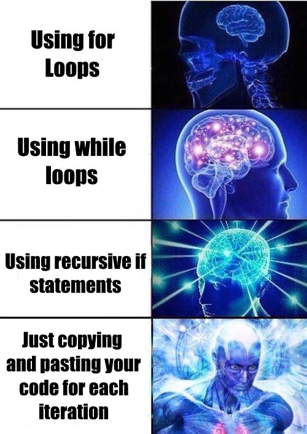

---

<table width="100%">
  <tr>
    <td width="60%" valign="top">

<h2>👨‍💻 About Me</h2>

I'm <b>Clément</b>, a computer science student at
<b>EPITA</b> and <b>42 Paris</b>.

At EPITA, I follow an engineering curriculum taught
entirely in English, with a strong focus on mathematics
and computer science.

At 42 Paris, I learn through intensive hands-on
programming, problem-solving and peer evaluation.

I especially enjoy <b>C, Python, algorithms</b>
and understanding how software works under the hood.

I'm also interested in <b>Artificial Intelligence</b>,
a field I hope to specialize in. I like keeping up
with technological developments and exploring
new concepts.

<pre>
$ whoami
Clément Jacob

$ education
EPITA &amp;&amp; 42 Paris

$ interests
Programming, Algorithms, AI

$ current_status
Casually trying to learn Rust 🦀
</pre>

  </td>
  <td width="40%" valign="top" align="center">

<h2>🛠️ Tech Stack</h2>

<h4>Languages</h4>

 

<h4>Tools &amp; Environment</h4>

 

<h4>Technical Knowledge</h4>

  </td>
  </tr>
</table>

---

## 🏆 One Thing I'm Proud Of

I was the **first to finish a Python programming exam at EPITA**, out of more than **750 students across all campuses**, with a score of **100%**.

---

## ❤️ I Love Coding
<i>I collect segmentation faults in my free time.</i>
 

### ⚡ The Art of Incrementing

I like C. Even the simplest lines of code can lead to surprisingly passionate discussions.

There's the obvious way to do something, and then there's the way that makes you feel clever for about five seconds.

I'll let the picture speak for itself.

 

 

### 🧠 Thinking Outside the Loop

One of my favorite things about programming is discovering how many ways there are to solve the same problem.

Sometimes you find a cleaner solution.

Sometimes you spend an hour rewriting something that worked perfectly fine.

Both are part of the experience.

 

 

---

### Stay tuned, more to come!

